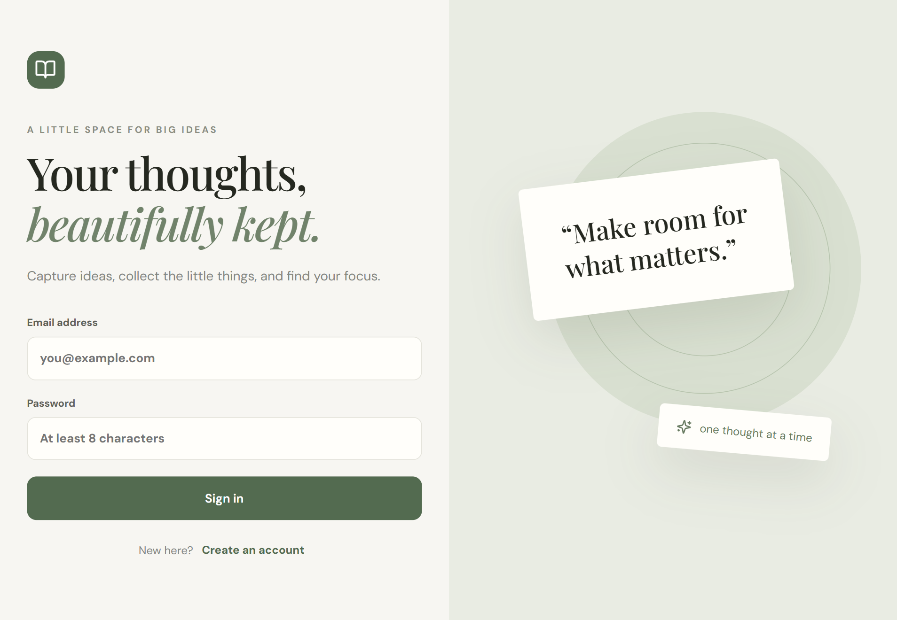
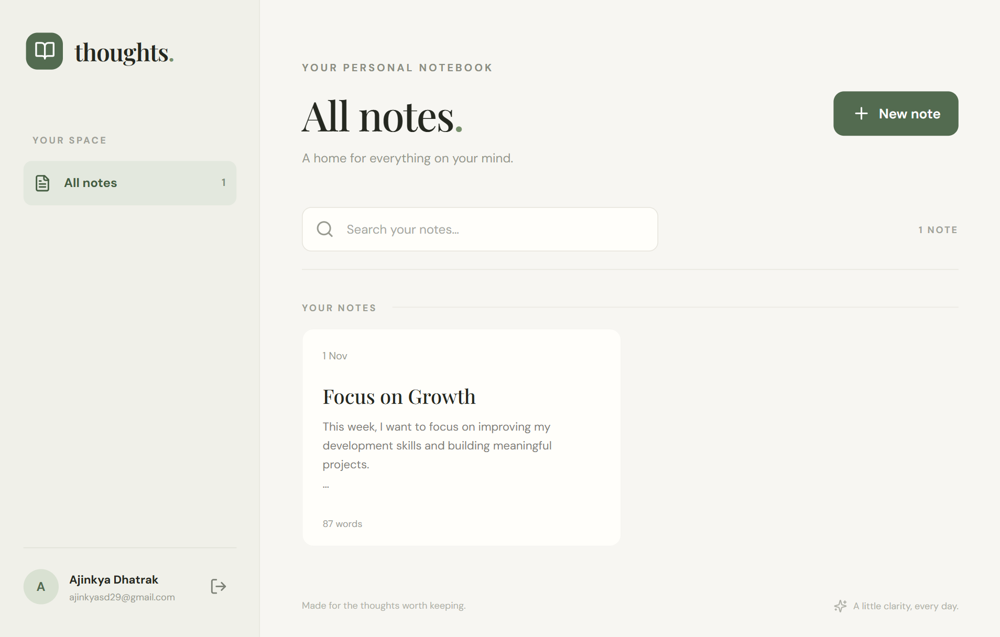

# 📝 MERN Notes App


A full-stack Notes Application built using the **MERN Stack (MongoDB, Express.js, React.js, and Node.js)**. It allows users to securely manage their personal notes with features like authentication, note creation, editing, deletion, pinning, and searching.

## 📸 Screenshots

<!-- Add your project screenshots inside the screenshots folder -->

### Login / Register


### Notes Dashboard


### Create / Edit Note


## ✨ Features

- **User Authentication:** Secure registration and login using JWT.
- **Password Hashing:** Passwords are encrypted using bcrypt.
- **Create Notes:** Create and save personal notes.
- **Edit Notes:** Update existing notes whenever needed.
- **Delete Notes:** Remove unwanted notes.
- **Pin Notes:** Pin important notes for quick access.
- **Search Notes:** Search notes by title or content.
- **Color Options:** Choose different background colors for notes.
- **Private Notes:** Each user can access only their own notes.
- **Responsive Design:** Clean and responsive user interface.
- **REST API:** Backend API built using Express.js.

## 🛠️ Tech Stack

**Frontend**
- React.js
- JavaScript
- HTML5
- CSS3
- Vite
- Lucide React Icons

**Backend**
- Node.js
- Express.js
- MongoDB
- Mongoose
- JWT Authentication
- bcrypt.js

## 📂 Project Structure

```text
mern-notes-app/
│
├── client/
│   ├── public/
│   ├── src/
│   │   ├── App.jsx
│   │   ├── api.js
│   │   ├── main.jsx
│   │   └── styles.css
│   ├── index.html
│   ├── package.json
│   └── vite.config.js
│
├── server/
│   ├── src/
│   │   ├── middleware/
│   │   │   └── auth.js
│   │   ├── models/
│   │   │   ├── Note.js
│   │   │   └── User.js
│   │   ├── routes/
│   │   │   ├── authRoutes.js
│   │   │   └── noteRoutes.js
│   │   └── server.js
│   ├── .env.example
│   └── package.json
│
├── .gitignore
├── package.json
└── README.md
```

## ⚙️ Installation and Setup

### 1. Clone the Repository

```bash
git clone https://github.com/ajinkya029/mern-notes-app.git
```

### 2. Navigate to the Project Directory

```bash
cd mern-notes-app
```

### 3. Install Dependencies

```bash
npm install
npm run install:all
```

### 4. Configure Environment Variables

Create a `.env` file inside the `server` directory.

Copy the following configuration:

```env
PORT=5000
MONGODB_URI=mongodb://127.0.0.1:27017/mern_notes
JWT_SECRET=your_secret_key
CLIENT_URL=http://localhost:5173
```

Replace `JWT_SECRET` with a strong, unique secret.

You can also use a MongoDB Atlas connection string instead of a local MongoDB connection.

### 5. Start the Application

Run the following command from the project root:

```bash
npm run dev
```

The application will be available at:

- **Frontend:** http://localhost:5173
- **Backend API:** http://localhost:5000

## 🔗 API Endpoints

### Authentication

| Method | Endpoint | Description |
|---|---|---|
| POST | `/api/auth/register` | Register a new user |
| POST | `/api/auth/login` | Login user |
| GET | `/api/auth/me` | Get current user |

### Notes

| Method | Endpoint | Description |
|---|---|---|
| GET | `/api/notes` | Get all user notes |
| POST | `/api/notes` | Create a new note |
| PUT | `/api/notes/:id` | Update a note |
| DELETE | `/api/notes/:id` | Delete a note |

**Note:** All notes endpoints require JWT authentication through the Authorization header.

```http
Authorization: Bearer YOUR_JWT_TOKEN
```

## 🚀 Production Build

Build the React frontend:

```bash
npm run build
```

Start the backend server:

```bash
npm start
```

The Express server serves the production frontend build when available.

## 🔒 Security

- Passwords are hashed using bcrypt.
- JWT is used for user authentication.
- Protected routes prevent unauthorized access.
- Notes are associated with individual user accounts.
- Environment variables are used for sensitive configuration.

## 👨‍💻 Author

**Ajinkya Dhatrak**

GitHub: [@ajinkya029](https://github.com/ajinkya029)

---

⭐ If you find this project useful, consider giving it a star!
